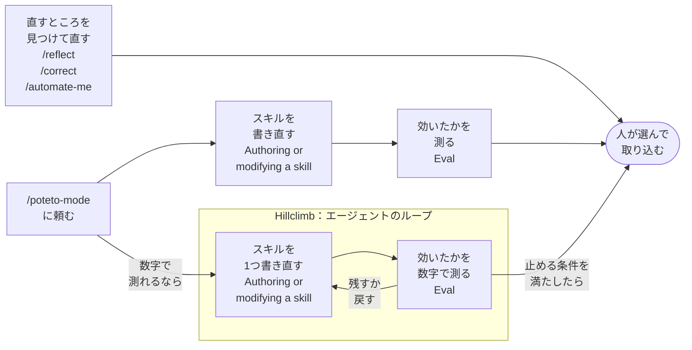

> **【執筆メモ：本文には出さない】記事の位置付け**
>
> - 1本目の具体編。1本目で考え方だけ書いた改善の仕組みを、それを担うスキルで書く。導入は1本目からつなぐ。
> - 主役は、5つのスキル（`/reflect`、`/correct`、`/automate-me`、`/create-verification-skill`、`/maintain-verification-skill`）が何をし、改善のループのどこを担うか。Playbook（Authoring or modifying a skill、Eval、Hillclimb）は数に入れないが、ループの「書く」「測る」を担うものとして扱う。使い方の話に寄りすぎない（`/poteto-mode` に触れるのはよいが、呼び方の説明を主にしない）。
> - 例は具体例として添える程度。全体を例で通さない。
> - pstackそのものの話をする。作者のやり方は扱わず、「pstackはこれらのスキルで作られた」とも書かない。
> - 読者: pstackを使っている、または使ってみたい人で、改善の仕組みを自分の環境で回したい人。
> - 材料はスキル本文とガイド（v0.15.25）。
> - 扱わない: 1本目とスキルの言い方のずれ、Claude Code対応、formal 版の確認スキル（後の版で追加。触れても一言）。
> - 締めは文章のまとめだけ。

## 1本目で考え方だけ書いた仕組みを、スキルで見る

[1本目の記事](https://zenn.dev/alchemist/articles/pstack-demystified)では、pstackの品質を支えているのは個々のスキルではなく、スキルを改善するやり方だと書きました。人が決めるのは、どこを改善するかと、結果を取り込むかどうかだけ。スキルの書き換えも、効いたかどうかの評価も、エージェントが受け持ちます。

そのときに書いたのは、考え方だけでした。pstackには、この改善の仕組みを自分のリポジトリで回すためのスキルが入っています。今回は、それぞれのスキルが何をし、どこを担うかを見ていきます（v0.15.25）。

## 人が回す2つのワークフロー

改善の仕組みは、人が回す2つのワークフローに分けると見やすくなります。5つのスキルと3つのPlaybookは、次のように分かれます。

- **確かめる手段を作り、保つワークフロー**: `/create-verification-skill`、`/maintain-verification-skill`
- **スキルを直すワークフロー**: 入口は2つ
  - 見つけるスキルが、そのまま直す: `/reflect`、`/correct`、`/automate-me`
  - `/poteto-mode` に頼んで、書き直して測る: PlaybookのAuthoring or modifying a skillとEval。数字が目標に届くまで繰り返すならPlaybookのHillclimbで、ここがエージェントだけで回るループになる

2つのワークフローは、どちらも人が始めて、人が結果を取り込みます。間の作業はエージェントがします。5つのスキルは、どれもエージェントが自分の判断では呼ばない設定です（frontmatterの `disable-model-invocation: true`）。人が `/reflect` のようにスラッシュコマンドで呼び出して始めます。

Playbookは `/poteto-mode` の中にあるタスク別の手順書で、スキルではありません（[2本目](https://zenn.dev/alchemist/articles/pstack-mechanism)）。それでも、書き直す、測る、Hillclimbを担うのはPlaybookなので、ここでは一緒に扱います。

## 確かめる手段を作り、保つワークフロー

最初にやるのは、エージェントが自分の作業を確かめる手段を用意することです。自分の作業を確かめられるエージェントは、確認が通るまで作業を続けます。確かめられなければ、結果を毎回人に戻して、手で確かめさせます。ガイドは、この確認用のスキルを[一番効くもの](https://github.com/cursor/plugins/blob/09d06eb/pstack/docs/guide/01-setup.md#L37)に挙げ、こうも書いています（筆者訳、以下同じ）。

> 自分の作業を確かめられないループは、確かめていない作業を速くするだけ。先に確認用のスキルを動くようにする。
> （[10-recipes-and-pitfalls.md L145](https://github.com/cursor/plugins/blob/09d06eb/pstack/docs/guide/10-recipes-and-pitfalls.md#L145)）

`/create-verification-skill` は、アプリを実際に動かして確かめるための、リポジトリ専用のスキル `verify-<app>` を作ります。中身は、アプリを起動し、ユーザーと同じように操作し、証拠を残す手順と、機能ごとの地図です。作ったスキルは、渡す前に実際に1回通して確かめます。「一度も実行していない生成スキルは、下書きであって成果物ではない」からです（[create-verification-skill/SKILL.md L40](https://github.com/cursor/plugins/blob/09d06eb/pstack/skills/create-verification-skill/SKILL.md#L40)）。

作った確認スキルにも、手入れが要ります。`/maintain-verification-skill` は、確認スキルを直し続けるスキルです。機能の地図は「アプリが変わった瞬間から古くなる」ので、地図にある機能をすべて実際に動かし、ずれを直します（[maintain-verification-skill/SKILL.md L9](https://github.com/cursor/plugins/blob/09d06eb/pstack/skills/maintain-verification-skill/SKILL.md#L9)）。直すのは確認スキルだけで、製品のコードには触りません。直しがあれば1本のPRにまとめ、人が取り込みます。ガイドは、これを1日1回以上、できれば定期実行で回すよう勧めています（[06-verify-and-ship.md L88](https://github.com/cursor/plugins/blob/09d06eb/pstack/docs/guide/06-verify-and-ship.md#L88)）。人が覚えていなくても、確かめる手段が古くならないようにするためです。

## スキルを直すワークフロー

入口は2つあります。

### 見つけるスキルが、そのまま直す

3つのスキルは、作業の記録から直すところを見つけ、そのまま直します。読む記録と直す先は、それぞれ違います。どれも、1回きりのことは拾いません。

| | 読む記録 | 直す先 |
|---|---|---|
| `/reflect` | 今の会話 | その会話で使ったスキル |
| `/correct` | 最近のコミット、revert、レビューコメント | リポジトリ |
| `/automate-me` | ここ数週間の会話 | 自分用の `-mode` スキル |

**`/reflect`** は、作業が終わった直後に呼び出します。直しの提案は「採用」「却下」「後回し」に仕分けられ、人が採用の一覧から1行ずつ選んだものだけを、その場で反映します。「スキルの変更は、組織の未来のすべてのエージェントに効く」からです（[reflect/SKILL.md L47](https://github.com/cursor/plugins/blob/09d06eb/pstack/skills/reflect/SKILL.md#L47)）。lintやスクリプトで強制できるものは、スキルの文章にせず「後回し」に回します。

**`/correct`** は、同じ間違いを、スキルではなくリポジトリを変えて起こせなくします。間違いの種類ごとに1コミットで直し、直し方には順番があります（[correct/SKILL.md L19–22](https://github.com/cursor/plugins/blob/09d06eb/pstack/skills/correct/SKILL.md#L19-L22)）。

1. 構造を変えて、その間違いが起きないようにする
2. 型で書けなくする。型で防げなければ、lintやCIで止める
3. テストで振る舞いを確かめる
4. 文書やエージェント向けのルールは最後。エージェントが読み飛ばしても、何も落ちないから

上の3段の直しは、エージェントが読み飛ばせません。間違えた時点で自動で落ちます。

**`/automate-me`** が作るのは、返答の好みや「完了」の基準といった自分の働き方をまとめた、`/poteto-mode` の自分版です。下書きを本人が読んで「自分らしいか」で確かめ、PRにします。評価は回しません。出力が主観的なものだからです（[automate-me/SKILL.md L96](https://github.com/cursor/plugins/blob/09d06eb/pstack/skills/automate-me/SKILL.md#L96)）。

### `/poteto-mode` に頼んで、書き直して測る

もう1つの入口は、`/poteto-mode` に「このスキルを直して、評価もして」と頼むことです。`/poteto-mode` は、頼んだ内容に合うPlaybookを選びます（[poteto-mode/SKILL.md L123](https://github.com/cursor/plugins/blob/09d06eb/pstack/skills/poteto-mode/SKILL.md#L123)）。書き直して測るのはエージェントで、ルートは2つあります。AuthoringとEvalで1回書き直して測るルートと、Hillclimbで数字が目標に届くまで繰り返すルートです。

**Authoring or modifying a skill** は、スキルを書く手順です。Cursor組み込みの `create-skill` で書き、frontmatterやリンクを確かめてPRにします。書き方の基準は「迷ったら消す。判断を変える文だけ残す」です（[authoring-a-skill.md L10](https://github.com/cursor/plugins/blob/09d06eb/pstack/skills/poteto-mode/playbooks/authoring-a-skill.md#L10)）。この手順は評価を自分では呼ばないので、ガイドは、評価も同じ依頼の中で頼むよう勧めています（[09-make-it-yours.md L82–88](https://github.com/cursor/plugins/blob/09d06eb/pstack/docs/guide/09-make-it-yours.md#L82-L88)）。

**Eval** は、変える前と後のスキルに同じ課題を解かせて比べる手順です。候補を複数のモデルで並列に走らせ、別系統のモデル1つが採点する仕組みは、`/arena` から借りています。一番気を配っているのは、エージェントに評価だと気づかせないこと。試されていると知ったエージェントは振る舞いが変わるので、課題は普通のユーザーの頼み方にし、evalやjudgeといった語も見せません（[eval.md L5–21](https://github.com/cursor/plugins/blob/09d06eb/pstack/skills/poteto-mode/playbooks/eval.md#L5-L21)）。最後に、変更を採用するかの推薦を返します（[L25](https://github.com/cursor/plugins/blob/09d06eb/pstack/skills/poteto-mode/playbooks/eval.md#L25)）。決めるのは人です。

なぜ毎回測るのか。ガイドの答えはこうです。

> 1回のまずい会話から書いた直しは、その会話に寄りすぎます。それを重ねるうちに、スキルは少しずつずれていく。評価は、そのずれを出荷前に捕まえます。
> （[09-make-it-yours.md L88](https://github.com/cursor/plugins/blob/09d06eb/pstack/docs/guide/09-make-it-yours.md#L88)）

**Hillclimb** は、1つの数字を目標まで上げ続ける手順です。「1つ変えて、測って、残すか戻す」を、止める条件を満たすまで繰り返します（[hillclimb.md L5](https://github.com/cursor/plugins/blob/09d06eb/pstack/skills/poteto-mode/playbooks/hillclimb.md#L5)）。止める条件は、目標と試行回数の下限の組で決めます。運よく早く当たっても止めないためで、条件を緩めて達成したことにもしません。始めるときに数字と止める条件を人と決めれば、あとは人がいなくても回せます。

Hillclimbは、測れるものなら何にでも使える汎用の手順です。スキルに使うなら、Evalの採点を数字にして、AuthoringとEvalと同じ書き直しと測定を繰り返します。違うのは、1回に1つだけ変えること、数字で測ること、残すか戻すかをその数字で自動で決めることです。そのため、人を待たずに回るループになります。

## まとめ

pstackの改善の仕組みは、人が回す2つのワークフローでできています。人はまず、エージェントが自分の作業を確かめる手段を作り、保ちます。そのうえで、スキルを直すワークフローを回します。入口は2つで、見つけるスキルにそのまま直させるか、`/poteto-mode` に書き直しと評価を頼むかです。どちらも、始めるのと取り込むかを決めるのは人で、間の作業はエージェントが受け持ちます。エージェントだけで回るのは、Hillclimbで数字が目標に届くまで繰り返すときです。

見つけるスキルは、直しをできるだけlintや型、テストのような、自動で落ちる仕組みに寄せます。人が繰り返し訂正していた間違いは、次からはエージェントの作業の中で止まるようになります。

## 参考

- [pstack（cursor/plugins）](https://github.com/cursor/plugins/tree/main/pstack)
- [pstack v0.15.25（cursor/plugins）](https://github.com/cursor/plugins/tree/09d06eb/pstack): この記事で読んだ版
- [Make it yours](https://github.com/cursor/plugins/blob/09d06eb/pstack/docs/guide/09-make-it-yours.md): 公式ガイドの、`/reflect`、`/correct`、`/automate-me`、Evalの章
- [Verify and ship](https://github.com/cursor/plugins/blob/09d06eb/pstack/docs/guide/06-verify-and-ship.md): 公式ガイドの、確認スキルの作り方と保ち方の章
- [pstackの謎を解く：Cursorの爆速開発を支えるスキルは、どう作られているか](https://zenn.dev/alchemist/articles/pstack-demystified): シリーズ1本目
- [pstackの謎を解く：たった一言の指示でPRまで。裏で何が動いているか](https://zenn.dev/alchemist/articles/pstack-mechanism): シリーズ2本目
- [pstackの謎を解く：月2,500件のPRを支えていたのは、速さではなかった](https://zenn.dev/alchemist/articles/pstack-code-quality): シリーズ3本目
