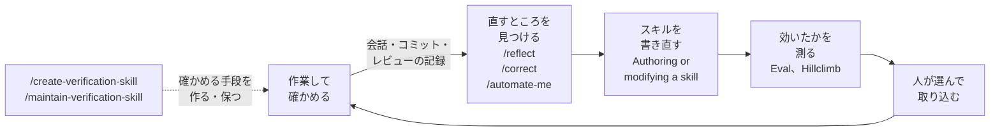

> **【執筆メモ：本文には出さない】記事の位置付け**
>
> - 1本目の具体編。1本目で考え方だけ書いた改善の仕組みを、それを担うスキルで書く。導入は1本目からつなぐ。
> - 主役は、5つのスキル（`/reflect`、`/correct`、`/automate-me`、`/create-verification-skill`、`/maintain-verification-skill`）が何をし、改善のループのどこを担うか。Playbook（Authoring or modifying a skill、Eval、Hillclimb）は数に入れないが、ループの「書く」「測る」を担うものとして扱う。使い方の話に寄りすぎない（`/poteto-mode` に触れるのはよいが、呼び方の説明を主にしない）。
> - 例は具体例として添える程度。全体を例で通さない。
> - pstackそのものの話をする。作者のやり方は扱わず、「pstackはこれらのスキルで作られた」とも書かない。
> - 読者: pstackを使っている、または使ってみたい人で、改善の仕組みを自分の環境で回したい人。
> - 材料はスキル本文とガイド（v0.15.25）。
> - 扱わない: 1本目とスキルの言い方のずれ、Claude Code対応、formal 版の確認スキル（後の版で追加。触れても一言）。
> - 締めは文章のまとめだけ。

## 1本目で考え方だけ書いた仕組みを、スキルで見る

[1本目の記事](https://zenn.dev/alchemist/articles/pstack-demystified)では、pstackの品質を支えているのは個々のスキルではなく、スキルを改善するやり方だと書きました。人が決めるのは、どこを改善するかと、結果を取り込むかどうかだけ。スキルの書き換えも、効いたかどうかの評価も、エージェントが受け持ちます。

そのときに書いたのは、考え方だけでした。pstackには、この改善のループを自分のリポジトリで回すためのスキルが入っています。今回は、それぞれのスキルが何をし、ループのどこを担うかを見ていきます（v0.15.25）。

## 改善のループを、5つのスキルと3つのPlaybookが分担する

改善のループは、次の5つのスキルと3つのPlaybookが分担しています。

| ループの段 | 担当 |
|---|---|
| 土台：作業を自分で確かめる手段を作り、保つ | `/create-verification-skill`、`/maintain-verification-skill` |
| 直すところを見つける | `/reflect`、`/correct`、`/automate-me` |
| スキルを書き直す | Playbookの Authoring or modifying a skill |
| 効いたかを測る | Playbookの Eval、Hillclimb |

ループの形にすると、次のようになります。

Playbookは `/poteto-mode` の中にあるタスク別の手順書で、スキルではありません（[2本目](https://zenn.dev/alchemist/articles/pstack-mechanism)）。それでも「書き直す」と「測る」を担うのはPlaybookなので、ここでは一緒に扱います。`/correct` だけは、見つけた間違いをスキルではなく、リポジトリの側で直します。

5つのスキルは、どれもエージェントが自分の判断では呼ばない設定です（frontmatterの `disable-model-invocation: true`）。改善を始めるのは人です。

## 土台：作業を自分で確かめる手段を作り、保つ

改善の話なのに確認のスキルから始めるのは、ガイドがこれを[一番効くスキル](https://github.com/cursor/plugins/blob/09d06eb/pstack/docs/guide/01-setup.md#L37)に挙げ、こう書いているからです（筆者訳、以下同じ）。

> 自分の作業を確かめられないループは、確かめていない作業を速くするだけ。先に確認用のスキルを動くようにする。
> （[10-recipes-and-pitfalls.md L145](https://github.com/cursor/plugins/blob/09d06eb/pstack/docs/guide/10-recipes-and-pitfalls.md#L145)）

`/create-verification-skill` は、アプリを実際に動かして確かめるための、リポジトリ専用のスキル `verify-<app>` を作ります。中身は、アプリを起動し、ユーザーと同じように操作し、証拠を残す手順と、機能ごとの地図です。作ったスキルは、渡す前に実際に1回通して確かめます。「一度も実行していない生成スキルは、下書きであって成果物ではない」からです（[create-verification-skill/SKILL.md L40](https://github.com/cursor/plugins/blob/09d06eb/pstack/skills/create-verification-skill/SKILL.md#L40)）。

作った確認スキルにも、手入れが要ります。`/maintain-verification-skill` は、確認スキルを直し続けるスキルです。機能の地図は「アプリが変わった瞬間から古くなる」ので、地図にある機能をすべて実際に動かし、ずれを直します（[maintain-verification-skill/SKILL.md L9](https://github.com/cursor/plugins/blob/09d06eb/pstack/skills/maintain-verification-skill/SKILL.md#L9)）。直すのは確認スキルだけで、製品のコードには触りません。アプリのほうが壊れていたら、地図をそれに合わせてごまかさず、報告します。

これも、スキルを改善するループの1つです。このあと紹介する3つのスキルが作業の記録を読むのに対して、こちらは動いているアプリそのものと照らし合わせます。

## 見つける：直すところを、作業の記録から拾う

改善の材料は、作業の記録です。3つのスキルは、読む記録と直す先がそれぞれ違います。どれも、1回きりのことは拾いません。

| | 読む記録 | 直す先 |
|---|---|---|
| `/reflect` | 今の会話 | その会話で使ったスキル |
| `/correct` | 最近のコミット、revert、レビューコメント | リポジトリ |
| `/automate-me` | ここ数週間の会話 | 自分用の `-mode` スキル |

**`/reflect`** は、作業の直後に打ちます。直しの提案は「採用」「却下」「後回し」に仕分けられ、人が採用の一覧から1行ずつ選ぶまで、スキルは書き換えません。「スキルの変更は、組織の未来のすべてのエージェントに効く」からです（[reflect/SKILL.md L47](https://github.com/cursor/plugins/blob/09d06eb/pstack/skills/reflect/SKILL.md#L47)）。

**`/correct`** は、同じ間違いを、リポジトリを変えて起こせなくします。直し方には順番があります（[correct/SKILL.md L19–22](https://github.com/cursor/plugins/blob/09d06eb/pstack/skills/correct/SKILL.md#L19-L22)）。

1. 構造を変えて、その間違いが起きないようにする
2. 型で書けなくする。型で防げなければ、lintやCIで止める
3. テストで振る舞いを確かめる
4. 文書やエージェント向けのルールは最後。エージェントが読み飛ばしても、何も落ちないから

**`/automate-me`** が作るのは、返答の好みや「完了」の基準といった自分の働き方をまとめた、`/poteto-mode` の自分版です。ほかと違って評価は回さず、本人が読んで「自分らしいか」で確かめます。出力が主観的なものだからです（[automate-me/SKILL.md L96](https://github.com/cursor/plugins/blob/09d06eb/pstack/skills/automate-me/SKILL.md#L96)）。

## 書き直して、測る：3つのPlaybook

見つけた直しをスキルに書き、効いたかを測るのは、`/poteto-mode` の中のPlaybookです。

**Authoring or modifying a skill** は、スキルを書く手順です。Cursor組み込みの `create-skill` で書き、frontmatterやリンクを確かめてPRにします。書き方の基準は「迷ったら消す。判断を変える文だけ残す」です（[authoring-a-skill.md L10](https://github.com/cursor/plugins/blob/09d06eb/pstack/skills/poteto-mode/playbooks/authoring-a-skill.md#L10)）。

**Eval** は、変える前と後のスキルに同じ課題を解かせて比べる手順です。一番気を配っているのは、エージェントに評価だと気づかせないこと。試されていると知ったエージェントは振る舞いが変わるので、課題は普通のユーザーの頼み方にし、evalやjudgeといった語も見せません（[eval.md L5–13](https://github.com/cursor/plugins/blob/09d06eb/pstack/skills/poteto-mode/playbooks/eval.md#L5-L13)）。

**Hillclimb** は、1つの数字を目標まで上げ続ける手順です。「1つ変えて、測って、残すか戻す」を繰り返し、「効くかもしれない」だけの変更は残しません（[hillclimb.md L5](https://github.com/cursor/plugins/blob/09d06eb/pstack/skills/poteto-mode/playbooks/hillclimb.md#L5)）。

なぜ毎回測るのか。ガイドの答えはこうです。

> 1回のまずい会話から書いた直しは、その会話に寄りすぎます。それを重ねるうちに、スキルは少しずつずれていく。評価は、そのずれを出荷前に捕まえます。
> （[09-make-it-yours.md L88](https://github.com/cursor/plugins/blob/09d06eb/pstack/docs/guide/09-make-it-yours.md#L88)）

## まとめ

pstackの改善のループは、確認スキルを土台にしています。土台は `/create-verification-skill` が作り、`/maintain-verification-skill` が保ちます。その上で、`/reflect`、`/correct`、`/automate-me` が作業の記録から直すところを拾い、Playbookでスキルを書き直して、効いたかを測ります。

どのスキルも、始めるのは人で、取り込むかを決めるのも人です。その間の、記録を読み、スキルを書き直し、測る作業を、エージェントが受け持ちます。

## 参考

- [pstack（cursor/plugins）](https://github.com/cursor/plugins/tree/main/pstack)
- [pstack v0.15.25（cursor/plugins）](https://github.com/cursor/plugins/tree/09d06eb/pstack): この記事で読んだ版
- [Make it yours](https://github.com/cursor/plugins/blob/09d06eb/pstack/docs/guide/09-make-it-yours.md): 公式ガイドの、`/reflect`、`/correct`、`/automate-me`、Evalの章
- [Verify and ship](https://github.com/cursor/plugins/blob/09d06eb/pstack/docs/guide/06-verify-and-ship.md): 公式ガイドの、確認スキルの作り方と保ち方の章
- [pstackの謎を解く：Cursorの爆速開発を支えるスキルは、どう作られているか](https://zenn.dev/alchemist/articles/pstack-demystified): シリーズ1本目
- [pstackの謎を解く：たった一言の指示でPRまで。裏で何が動いているか](https://zenn.dev/alchemist/articles/pstack-mechanism): シリーズ2本目
- [pstackの謎を解く：月2,500件のPRを支えていたのは、速さではなかった](https://zenn.dev/alchemist/articles/pstack-code-quality): シリーズ3本目
