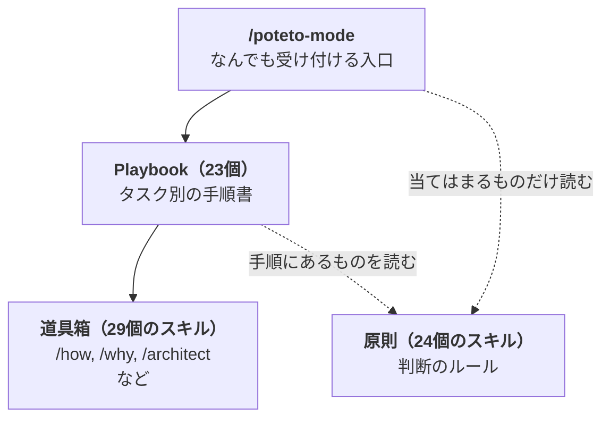
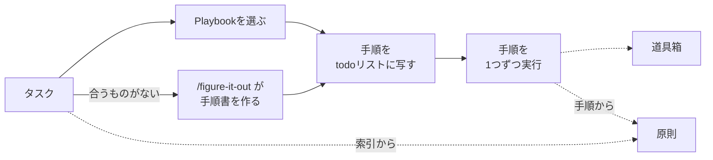

## 使うのは簡単。でも、中の仕組みが知りたくなる

pstackは、Cursorの公式プラグインの1つです。`/poteto-mode` にタスクを渡すと、エージェントが手順を選び、作業して、実物で確かめるところまで進めます。

使うだけなら、迷うところはありません。何をするにも `/poteto-mode` に渡せばよく、どのスキルを使うかはエージェントが決めてくれます。ただ、私はどうしても、中の仕組みが知りたくなります。

[前回の記事](https://zenn.dev/alchemist/articles/pstack-demystified)では、pstackがどう作られてきたかを追いました。今回は中の仕組みのほうを、スキル同士の参照を数えて一枚に描きました。**全体は、3つの層と、横に置かれた道具箱でできています。**

## pstackは、3つの層と道具箱でできている

3つの層は、入口の `/poteto-mode`、タスク別の手順書のPlaybook、判断のルールの原則です。その横に、道具箱があります。数は次のとおりです（v0.15.25時点）。

- スキル（54個）
  - `/poteto-mode`
  - 原則: 24個
  - 道具箱: 29個
- スキルではないもの
  - Playbook: 23個。`/poteto-mode` の中にある手順書



**`/poteto-mode`** は、なんでも受け付けるpstackの入口です。中には、原則の索引とPlaybookの一覧が入っています。

**Playbook** は、タスク別の手順書です。`/poteto-mode` はタスクに合うものを1つ選び、その手順に沿って作業を進めます。たとえば次のようなものがあります。

- Bug fix: バグ修正
- Feature: 機能追加
- Investigation: コードを変えずに調べる

**原則** は、判断のよりどころになるルールで、1つが1つのスキルになっています。たとえば次のようなものがあります。

- Fix Root Causes: 症状ではなく根本原因を直す
- Prove It Works: 実物で動くことを確かめる
- Subtract Before You Add: 足す前に、まず要らないものを削る

索引には、原則ごとに「どんなときに使うか」が短く書かれています。エージェントはそれを見て、当てはまる原則だけ本文を読みに行きます。Playbookのほうも、23個のうち15個が、手順の中で使う原則を指定しています。

**道具箱** は、残りの単独スキルです。手順や `/poteto-mode` 本体から呼ばれるものには、次のようなものがあります。

- `/how`: 仕組みを説明する
- `/why`: なぜそうなったかを履歴から調べる
- `/architect`: コードを書く前に型と構成を決める

道具箱には、手順からは呼ばれず、人が直接打って使うものもあります。

- `/teach`: 理解できるまで説明する
- `/recall`: 過去のチャットから作業の文脈を復元する

## タスクを渡すと、どう流れるか

`/poteto-mode` がタスクを受け取ってからの基本の流れは、どのタスクでも同じです。



合うPlaybookがなければ、`/figure-it-out` というスキルがその場で手順書を作ります。

エージェントは、手順書にない原則も使います。索引はタスクの最初に読みます。当てはまる原則があれば、その本文も読みます。作業が終わるとエージェントは作業報告を返し、使った原則があれば、その名前と、それで変わった判断も書きます。

### 例：バグ修正を渡した場合

READMEにある例を日本語に訳して使います。

```
/poteto-mode このPRに、何もしていなくても750msごとにスクロールがずれるバグがある。
まず再現してから、直して確かめて。
```

`/poteto-mode` はこれをBug fixのPlaybookに振り分け、6つの手順をtodoリストに写します。todoリストは、エージェントが作業中に画面に出す「やることリスト」です。手順がそのまま並ぶので、いまどこを進めているかが見えます。

1. バグが起きることを実際に確かめる
2. 原因を絞る（`/how`、`/why` で仮説を立てる）
3. 修正を計画する（必要なら `/architect`）
4. 同じ環境で、バグが起きなくなったことを確かめる
5. バグが起きることを示すテストなどを先にコミットし、修正をその上に積む（原則のSequence Work into Verifiable Unitsを指定）
6. PRを開くためのPlaybook「Opening a PR」に進む

例文では再現と確認まで頼んでいますが、頼まなくても流れは同じです。手順1と手順4に、最初から入っています。

原因を絞るときには、手順書にないFix Root Causes（根本原因を直す）も、索引を見て使います。

最後に、何が壊れていたか、根本原因、修正、どう確かめたかを並べた作業報告を返します。

## 中身を読むなら、この順で足りる

仕組みを知りたくなった人向けに、読み方も書いておきます。

1. `/poteto-mode` のSKILL.md。特に原則の索引とPlaybookの一覧
2. 自分のタスクに近いPlaybookを1つ
3. 原則は、作業報告に名前が出てきたら、そのときに読む

## 参考

- [pstack（cursor/plugins）](https://github.com/cursor/plugins/tree/main/pstack)
- [pstack v0.15.25（cursor/plugins）](https://github.com/cursor/plugins/tree/09d06eb/pstack): この記事で読んだ版
- [Route work through /poteto-mode](https://github.com/cursor/plugins/blob/main/pstack/docs/guide/02-poteto-mode.md): 公式ガイドの `/poteto-mode` の章
- [pstackの謎を解く：Cursorの爆速開発を支えるスキルは、どう作られているか](https://zenn.dev/alchemist/articles/pstack-demystified): 前回の記事。pstackがどう作られてきたか
