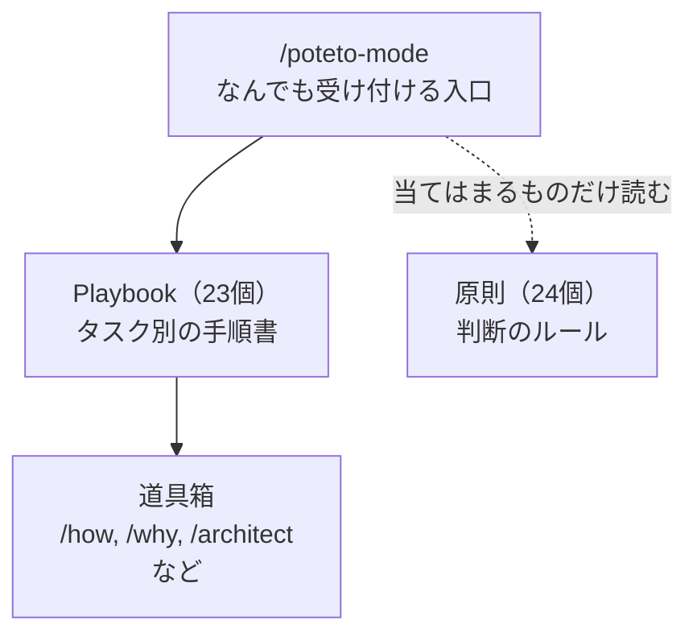
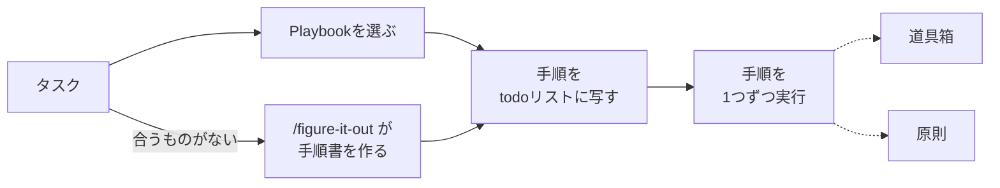

> **【執筆メモ：本文には出さない】記事の位置付け**
>
> - pstack-demystified の続編（シリーズ2本目）。
> - 1本目の冒頭で「スキルと原則とタスク別の手順書が網の目のように参照しあっていて、全体像がぼやけた」と書いた部分の答え合わせ。
> - pstackの全体の地図を示す。
> - 改善ループの話は3本目（pstack-sequel-improvement-loop）に回す。

> **【執筆メモ：本文には出さない】残っている作業**
>
> - fact-check スキルで、引用と数字を原文（`09d06eb`）と照合する。日本語訳（`pstack-ja/`）は古い版なので使わない
> - タイトル、slug、ファイル名を決め、`zenn-articles/` に移す

## 使うのは簡単。でも、中の仕組みが知りたくなる

pstackは、Cursorの公式プラグインの1つです。`/poteto-mode` にタスクを渡すと、エージェントが手順を選び、作業して、実物で確かめるところまで進めます。

使うだけなら、迷うところはありません。何をするにも `/poteto-mode` に渡せばよく、どのスキルを使うかはエージェントが決めてくれます。ただ、私はどうしても、中の仕組みが知りたくなります。

[前回の記事](https://zenn.dev/alchemist/articles/pstack-demystified)では、pstackがどう作られてきたかを追いました。今回は中の仕組みのほうを、スキル同士の参照を数えて一枚に描きました。**全体は、3つの層と、横に置かれた道具箱でできています。**

## pstackは、3つの層と道具箱でできている



**`/poteto-mode`** は、なんでも受け付けるpstackの入口です。中には、原則の索引とPlaybookの一覧が入っています。

**Playbook** は、タスク別の手順書です。`/poteto-mode` はタスクに合うものを1つ選び、その手順に沿って作業を進めます。たとえば次のようなものがあります。

- Bug fix: バグ修正
- Feature: 機能追加
- Investigation: コードを変えずに調べる

**原則** は、判断のよりどころになるルールで、1つが1つのスキルになっています。たとえば次のようなものがあります。

- Fix Root Causes: 症状ではなく根本原因を直す
- Prove It Works: 実物で動くことを確かめる
- Subtract Before You Add: 足す前に、まず要らないものを削る

索引には、原則ごとに「どんなときに使うか」が1行で書かれています。エージェントはそれを見て、当てはまる原則だけ本文を読みに行きます。

**道具箱** は、残りの単独スキルです。手順の中で呼ばれるものには、次のようなものがあります。

- `/how`: 仕組みを説明する
- `/why`: なぜそうなったかを履歴から調べる
- `/architect`: コードを書く前に型と構成を決める

道具箱には、手順からは呼ばれず、人が直接打って使うものもあります。

- `/teach`: 理解できるまで説明する
- `/recall`: 過去のチャットから作業の文脈を復元する

## タスクを渡すと、どう流れるか

`/poteto-mode` がタスクを受け取ってからの基本の流れは、どのタスクでも同じです。



合うPlaybookがなければ、`/figure-it-out` というスキルがその場で手順書を作ります。

READMEにあるバグ修正の例（日本語に訳したもの）で、具体的に追います。

```
/poteto-mode このPRに、何もしていなくても750msごとにスクロールがずれるバグがある。
まず再現してから、直して確かめて。
```

`/poteto-mode` はこれをBug fixのPlaybookに振り分け、6つの手順をtodoリストに写します。todoリストは、エージェントが作業中に画面に出す「やることリスト」です。手順がそのまま並ぶので、いまどこを進めているかが見えます。

1. バグが起きることを実際に確かめる
2. 原因を絞る（`/how`、`/why` で仮説を立てる）
3. 修正を計画する（必要なら `/architect`）
4. 同じ環境で、バグが起きなくなったことを確かめる
5. バグが起きることを示すテストなどを先にコミットし、修正をその上に積む
6. PRを開くためのPlaybook「Opening a PR」に進む

手順に書かれていなくても、原則は使われます。たとえば原因を絞る段階では、索引に「デバッグのとき」とあるFix Root Causes（根本原因を直す）が当てはまり、エージェントはその本文を読みに行きます。上の図で、原則へ伸びる点線の部分です。

作業が終わると、エージェントが作業報告を返します。そこには、何が壊れていたか、根本原因、修正、どう確かめたかが並びます。原則を使ったときは、その名前と、それで変わった判断も書かれます。

## 中身を読むなら、この順で足りる

仕組みを知りたくなった人向けに、読み方も書いておきます。

1. `/poteto-mode` のSKILL.md。特に原則の索引とPlaybookの一覧
2. 自分のタスクに近いPlaybookを1つ
3. 原則は、作業報告に名前が出てきたら、そのときに読む
